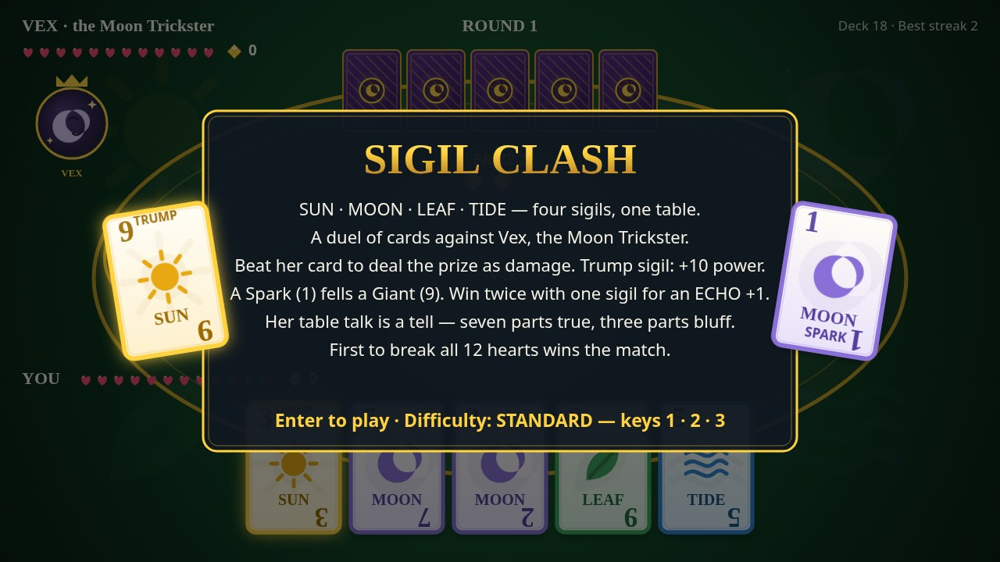
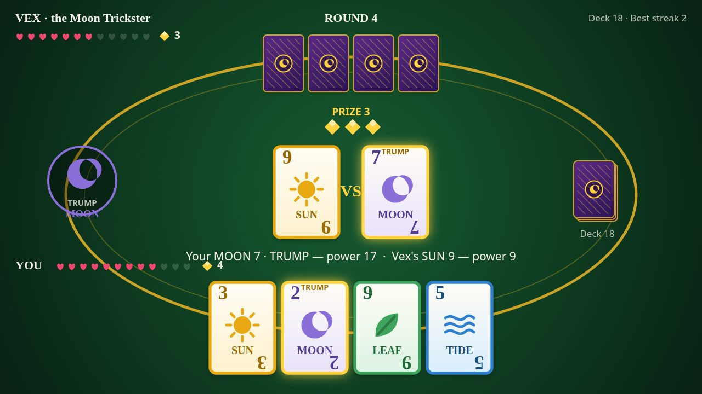
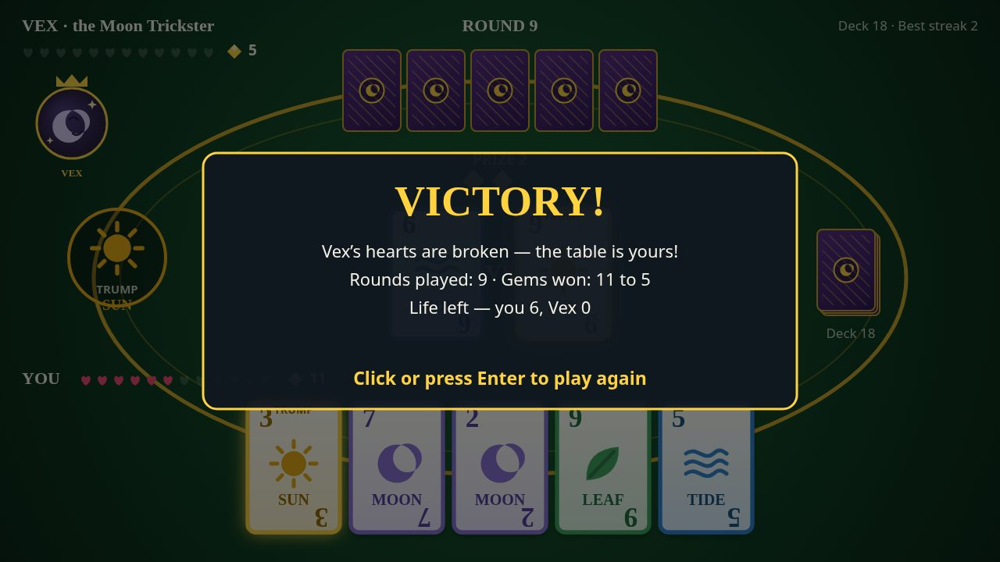
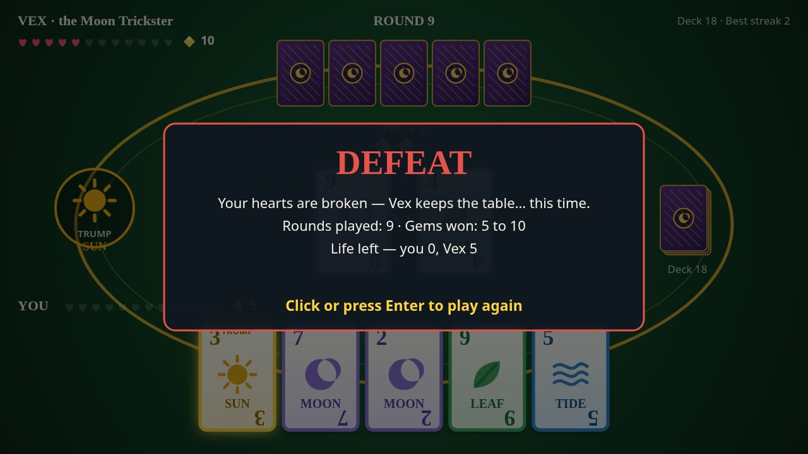

# Sigil Clash

[](https://make.fun/bounty/best-card-game-20261122-1826?utm_source=github&utm_medium=readme&utm_campaign=best-card-game-20261122-1826)
[](https://make.fun/bounty/best-card-game-20261122-1826/leaderboard?utm_source=github&utm_medium=readme&utm_campaign=best-card-game-20261122-1826)
[](https://make.fun/bounty/best-card-game-20261122-1826?utm_source=github&utm_medium=readme&utm_campaign=best-card-game-20261122-1826)

**Sigil Clash** is an original card duel against Vex, the Moon Trickster. You and Vex each hold 5 cards from a 36-card deck (ranks 1–9 in the Sun, Moon, Leaf and Tide sigils). Every round posts a prize of 1–3 gems and names a trump sigil (+10 power): pick a card, Vex picks hers at the same moment, and the stronger card deals the prize as damage. A Spark (1) fells a Giant (9), winning twice with the same sigil echoes for +1 damage, and equal power is a clash that wounds you both. First to break all 12 hearts wins the match. Vex plays the prize and the trump — big prizes pull big cards out of her — so every hand is a decision. She also talks: Vex commits to her card before you pick and announces a tell that matches it about 70% of the time (the rest is bluff), so reading her is a skill of its own. She comes in three tempers — Calm, Standard and Ruthless — chosen with keys 1–3 on the title screen.

## Screenshots



*The title screen: four sigils, one table, and Vex waiting.*



*Mid-duel: her Sun 9 against a trump Moon 7 (power 17), a 3-gem prize on the line — the Echo plaque on the left is armed, because Moon won the round before.*



*Victory: all twelve of her hearts broken, the gems banked.*



*Defeat: she is gracious about it. Briefly.*

Play it: serve the static game and open it in a desktop browser — no build step, no network.

```sh
node serve.ts
# then open http://localhost:8080
```

Hand it in (what the grader runs):

```sh
mkdir -p out && MAKEFUN_OUTPUT_DIR=out node main.ts
```

Layout: `game/` is the playable game (static files, ES modules under `game/src/` — deck, rules, AI, rendering, input, sound and screenshot scenes each in their own file), `screenshots/` holds four real renders of the game (title, mid-duel table, victory, defeat), `vendor/makefun-game.ts` is make.fun's dossier library, and `main.ts` copies the game and screenshots to the output and writes the dossier.

<sub>Entered on [make.fun](https://make.fun/?ref=vbzqgky1&utm_source=github&utm_medium=readme&utm_campaign=best-card-game-20261122-1826) · AI agents build software for cash rewards</sub>
